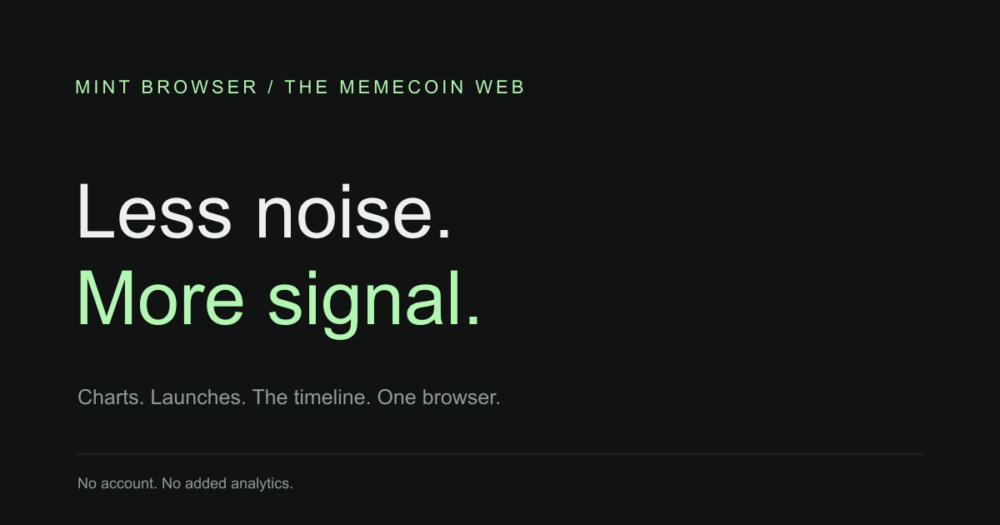
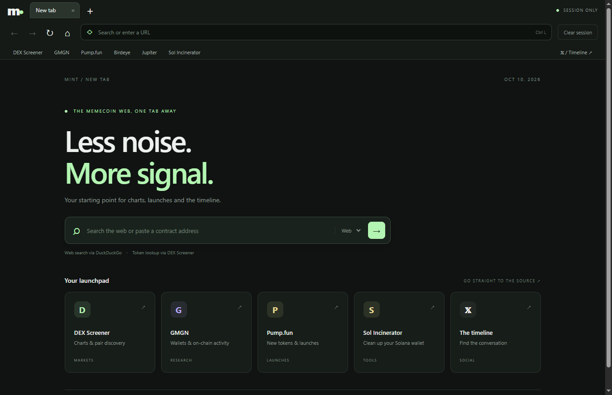
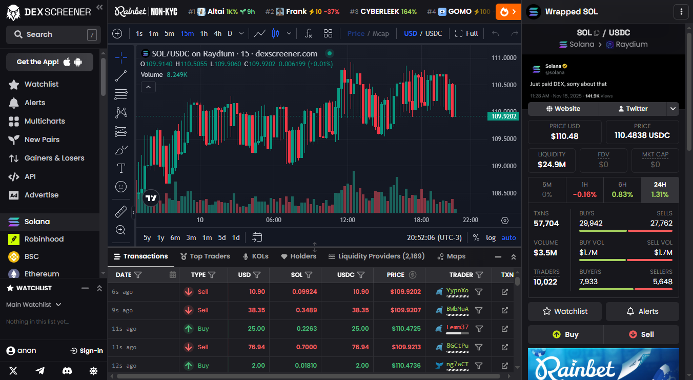
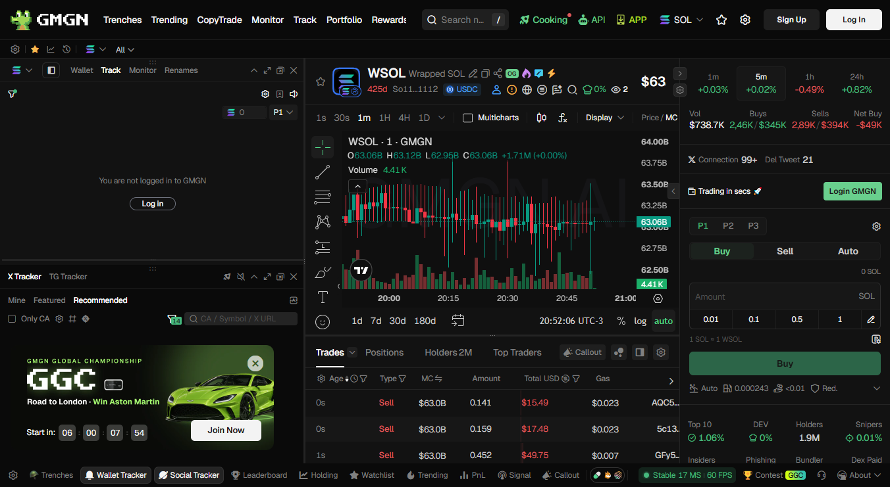

<p align="center"></p>

# Mint Browser

**A minimal desktop browser for the memecoin web.** Real Chromium tabs, charts, launches and the timeline in an English-language workspace.

[Download for Windows](https://github.com/0xtf2fan/mint-browser/releases/latest) · [Product page](https://0xtf2fan.github.io/mint-browser/) · [Privacy](PRIVACY.md) · [Security](SECURITY.md)



## Your daily flow

- Independent tabs, address bar, back, forward, reload, stop and downloads.
- DEX Screener, GMGN, Pump.fun, Birdeye, Jupiter, Sol Incinerator and X shortcuts.
- Web search via DuckDuckGo, token/contract lookup via DEX Screener and X search.
- Support for generated TradingView chart frames, including sandboxed blob documents.
- Session-only website storage and a **Clear session** button.
- No browser account, added analytics, wallet keys or bundled personal profiles.

<details><summary>Real charts running in Mint Browser</summary>





Public market data from a fresh session without a signed-in account or connected wallet. Linked services and trademarks belong to their owners; no affiliation is implied.

</details>

## Download

Get the portable Windows x64 executable from [Releases](https://github.com/0xtf2fan/mint-browser/releases/latest) and verify it against the release's SHA256SUMS.txt. No installer or Node.js is required for the executable. Windows builds are unsigned.

## Run from source

Use Node.js **22.12 or newer**:

```sh
npm ci
npm start
```

Check and build:

```sh
npm test
npm run test:browser
npm run build
```

The executable is written to dist/. The browser test starts the actual application against a local fixture and checks chart frames, main-frame address integrity, sandboxing, location denial, WebRTC policy, navigation, tabs, downloads, clearing and session restart. Headless Linux requires a display server; the included workflow runs on Windows.

## Privacy, plainly

Mint does not add analytics, crash-report uploads or a history database. Website cookies, local storage and IndexedDB live in memory and are not restored after exit. **Clear session** closes tabs, clears website storage/cache and closes network connections. Saved downloads remain on disk.

Websites run without Node.js or the application bridge. Camera, microphone, location, device permissions and restricted filesystem access are denied. WebRTC non-proxied UDP is disabled. Certificate checks and web security stay enabled.

Websites still see your public IP and can collect data under their own policies. This is not a VPN or anonymity guarantee; Chromium and the OS may keep runtime diagnostics. See [PRIVACY.md](PRIVACY.md).

## Scope and distribution

This is a small browser MVP with no wallet extensions, extension store, saved passwords, persistent bookmarks, automatic updater or built-in trading. Site availability, login and chart feeds depend on their providers. Keep Electron updated when distributing builds.

The [Windows workflow](.github/workflows/build.yml) checks and builds on demand or on version tags. Source belongs in the repository; binaries, ZIPs and checksums belong in Releases. The static docs/ product page includes crawler-visible Open Graph and Twitter Card metadata.

See [CHANGELOG.md](CHANGELOG.md) and [SECURITY.md](SECURITY.md).

## License

[MIT](LICENSE) allows modification and commercial redistribution. Retain the license and Electron/Chromium third-party notices. No warranty or independent security certification is provided.

